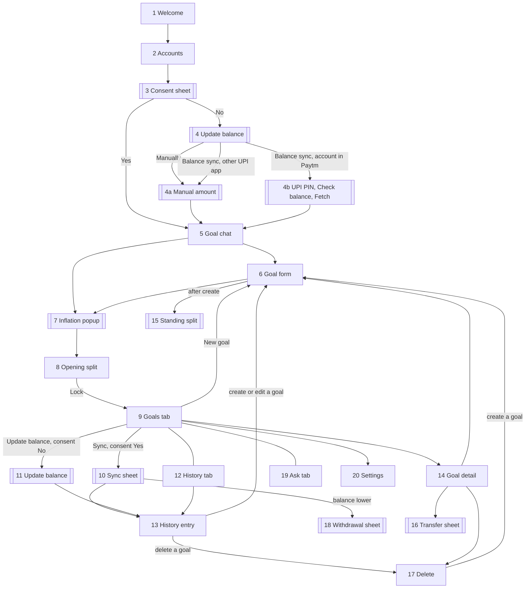

# PiPlanner — Screen-wise App Flow

Each screen lists what it shows, what the customer can do, and where each action goes. Numbers are the demo profile from the plan. Shopping and the spending account appear on no screen after Accounts.

## Navigation map

Screens 1–8 are a one-time setup stack. Screens 9, 12, and 19 are the tabs. Double-bordered nodes are sheets.

## Setup

### 1. Welcome
- **Shows:** PiPlanner, "Every Rupee Has a Plan.", one line of explanation, "Powered by Grok".
- **Actions:** Set up savings → Accounts.

### 2. Accounts
- **Shows:** Savings ₹1,00,000 and Spending ₹72,000, each with bank name and masked label. Spending is captioned "Everyday spend. Not split across goals."
- **Actions:** "Dedicated savings" toggle; turning one on turns the other off. Continue → Consent sheet.
- **States:** Continue is disabled until exactly one account is dedicated.

### 3. Consent sheet
Asked for the dedicated account, the one where credits and income arrive.
- **Shows:** With Yes, PiPlanner reads this balance automatically; the previous balance is stored to find the new amount; no statement, payee, UPI id, or account number goes to Grok; it can be changed in Settings.
- **Actions:** Yes, update automatically → Goal chat, with the opening balance fetched. No, I'll update it myself → Update balance.

### 4. Update balance (consent No)
Used for the opening balance during setup, and again for every later update.
- **Shows:** Two choices: Manually, and Balance sync.
- **Manually** → 4a Manual amount.
- **Balance sync**, account linked in Paytm → 4b UPI PIN.
- **Balance sync**, account on another UPI app → a line, "This account is not linked in Paytm, so we can't check it. Enter the balance instead." → 4a Manual amount.

### 4a. Manual amount
- **Shows:** One rupee field. During setup: "How much is in this account?" Later: "How much did you add?" with a "Record a withdrawal" link.
- **Actions:** Continue → Goal chat during setup, or an open History entry later.
- **States:** Continue is disabled at ₹0.

### 4b. UPI PIN → Check balance → Fetch
- **Shows:** Bank name and masked label, "Check balance. No money is debited.", a PIN pad. In the prototype the pad is a mock, labelled "Demo".
- **Actions:** Enter PIN → Check balance → the balance is shown, then Continue → Goal chat during setup, or the Sync sheet (previous, fetched, new amount) later.
- **States:** A wrong or cancelled PIN returns to Update balance with the Manually option still available.

### 5. Goal chat
- **Shows:** "What are you planning for?" with a text field and one demo chip.
- **Actions:** Send a sentence → goal drafts on a proposal card. At most two follow-ups. Edit → Goal form. Continue → Inflation popup. "Fill a form instead" → Goal form.
- **States:** Continue is disabled until percentages sum to 100. If Grok is unavailable, the Goal form opens directly.

### 6. Goal form (create and edit share this screen)
- **Fields:** Name, target amount, start date, end date, inflation (opens the popup), share of new amounts (%). When this is the only goal the share is prefilled at 100% and not editable.
- **Read-only:** Current saving, adjusted target, required savings.
- **Create:** Save → Standing split, or back to the History entry or Delete screen it was opened from.
- **Edit:** A fixed note: "Changes apply at the next credit. Earlier history stays as it is." Save → back, and the goal card shows "Change saved. Applies at the next credit."
- **States:** Save is disabled if the name is empty, the target is zero, or the end date is not after the start date.

### 7. Inflation popup
- **Shows:** Stepper at 7%, one Grok sentence, "Estimate, not a guarantee." The adjusted target updates as the stepper moves.
- **Actions:** Use this rate → returns to the caller.

### 8. Opening split
- **Shows:** Dedicated savings ₹1,00,000. Car 60% → ₹60,000, needs ₹26,058 a month. Emergency 40% → ₹40,000, needs ₹14,500 a month.
- **One goal:** the screen shows that goal at 100% → the full balance, with no sliders.
- **Actions:** Adjust percentages. Lock this split → writes the opening History entry, stores the snapshot, opens the Goals tab.

## Tabs and their screens

### 9. Goals tab
- **Shows:** Dedicated savings balance, "Last synced" (or "Last updated" with consent No), one card per goal. A banner when a History entry is still open: "₹50,000 to assign".
- **Actions:** Sync (consent Yes) or Update balance (consent No). New goal → Goal form. Transfer. Tap a card → Goal detail. Gear → Settings. Banner → the open History entry.
- **States:** Sync and Update balance are disabled while an entry is open. With no new credit, Sync shows "No new credit since the last sync."

### 10. Sync sheet
- **Shows:** Previous balance ₹1,00,000, fetched ₹1,50,000, new amount ₹50,000.
- **Actions:** Continue → writes an open History entry with the suggested split and opens it. If the fetched balance is lower → Withdrawal sheet.

### 11. Update balance (consent No)
The same sheet as screen 4, opened from the Goals tab.
- **Manually** → Manual amount → writes an open History entry for the typed amount and opens it.
- **Balance sync**, account in Paytm → UPI PIN → Check balance → Sync sheet → open History entry.
- **Balance sync**, other UPI app → Manual amount.

### 12. History tab
- **Shows:** Entries, newest first. Each shows the date, previous balance, new balance when it was fetched, new amount, and the split. Types: Opening, Credit, Credit (typed), Transfer, Goal deleted, Withdrawal. An open entry is marked "Assign now".
- **Actions:** Tap an entry → History entry.

### 13. History entry
**Open (new, not yet saved).** This is where the customer works on that amount, once.
- **Shows:** Previous ₹1,00,000, balance now ₹1,50,000, new amount ₹50,000. An "Already saved" block (Car ₹60,000, Emergency ₹40,000). Suggested split: Car ₹30,000 (60%), Emergency ₹20,000 (40%).
- **Actions:**
  - Save → freezes the entry as suggested.
  - Update percentages for this amount → sliders, must sum to 100.
  - Create a goal → Goal form, returns with the goal in the split. Switch, on by default: "Use this split from the next credit too."
  - Edit a goal → Goal form (edit). Stored for the next transaction.
  - Delete a goal → Delete screen.
  - Type to Grok → a proposal card.
- **Demo:** Car 50% ₹25,000, Emergency 30% ₹15,000, Vacation 20% ₹10,000. Car shows "₹1,058 behind this month."

**Saved.** Read-only record with a lock and, if changed, a "Custom split" tag. No actions.

### 14. Goal detail
- **Shows:** Name, saved, adjusted target, required per month, dates, inflation, share. Below, this goal's slices from History.
- **Actions:** Edit → Goal form. Transfer → Transfer sheet. Delete → Delete screen.

### 15. Standing split sheet
- **Opens when:** a goal is created outside an open entry and there are now two or more goals. With one goal it is skipped and that goal is set to 100%.
- **Shows:** All goals with percentage fields and a running total. Caption: "Used for the next credit. Saved money stays where it is."
- **Actions:** Save, enabled at 100%.

### 16. Transfer sheet
- **Shows:** From, To, amount, and the resulting saved and required figures.
- **Demo:** ₹5,000 Emergency → Car. Car ₹90,000, Emergency ₹50,000.
- **Actions:** Confirm → writes a transfer entry. The amount cannot exceed what the From goal has saved.

### 17. Delete (saving-percentage screen)
- **Shows:** "Deleting Vacation releases ₹10,000." Remaining goals with an equal split: Car 50% → ₹5,000, Emergency 50% → ₹5,000.
- **Actions:** Edit the percentages once (demo: 60/40 → ₹6,000 / ₹4,000). Create a goal → Goal form; the split becomes equal across all goals again. Confirm → writes the entry, removes the goal, renormalises the standing split.
- **States:** With one goal left, Confirm is disabled until a goal is created here.
- **Second example:** deleting Emergency when only Car remains shows Car 100%; adding Vacation changes it to Car 50%, Vacation 50%.

### 18. Withdrawal sheet
- **Opens when:** the fetched balance is lower than the stored one, or from "Record a withdrawal" on Manual amount.
- **Shows:** The amount withdrawn and a reduction per goal in proportion to its saving.
- **Actions:** Edit once (sums to the withdrawn amount, no goal below ₹0). Confirm → writes a withdrawal entry.

### 19. Ask tab
- **Shows:** Chat with two starters: "What happens if I change the split?" and "Why is inflation 7%?"
- **Actions:** Questions are answered from engine numbers. Action sentences return a proposal card whose Confirm opens the matching sheet, pre-filled.

### 20. Settings
- **Shows:** Linked accounts, Balance sync switch, Reset demo.
- **Shows also:** whether the dedicated account is linked in Paytm.
- **Actions:** Automatic balance updates off → consent No (Update balance replaces Sync). On → Consent sheet. Reset demo → Welcome.

## What each action writes

| Action | History entry | Standing split | Goal totals |
|---|---|---|---|
| Lock opening split | Opening, saved | Set | Set |
| Sync or Update balance (any route) | Credit, open | Unchanged | Unchanged until Save |
| Save entry | Frozen | Unchanged, unless the switch is on | Updated |
| Create goal | None | Reopened | New goal at ₹0 |
| Edit goal | None | Held until the next entry | Unchanged |
| Transfer | Transfer, saved | Unchanged | Updated for both |
| Delete goal | Goal deleted, saved | Renormalised | Released amount redistributed |
| Withdrawal | Withdrawal, saved | Unchanged | Reduced |
