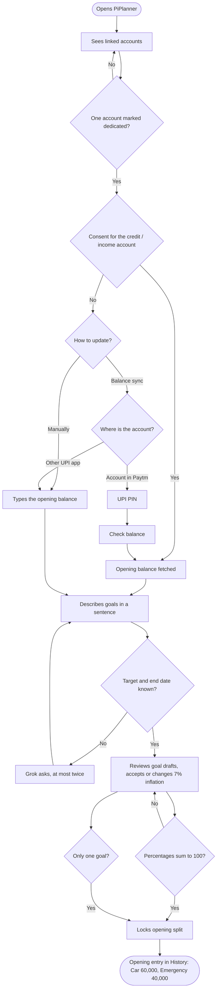
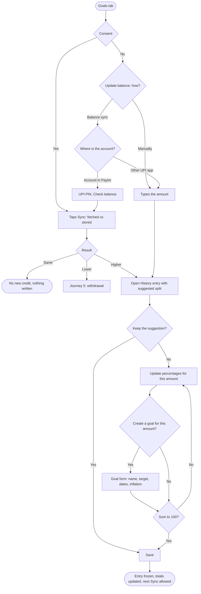
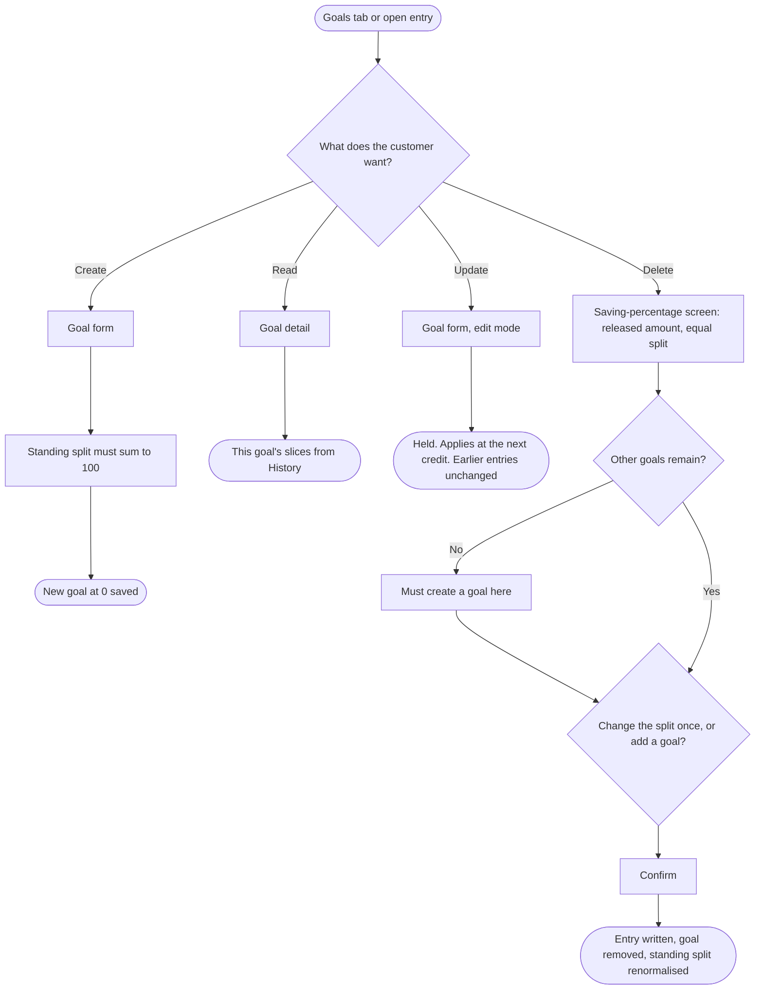

# PiPlanner — User Flow

The journeys a customer takes, the decisions inside them, and the rule at each decision. Screen contents are in SCREEN_FLOW.md. Shopping is never part of any flow.

FigJam boards: [User flow](https://www.figma.com/board/Z6HYzZKbAqrHjRqKb5mItB) · [App flow](https://www.figma.com/board/q9gB65WYRUGiQIybdN9yz5)

## In plain language

1. Choose the savings account this plan will use.
2. Say Yes to automatic balance updates, or No and update it yourself: type it, or check the balance with your UPI PIN if the account is in Paytm.
3. Name the goals. PiPlanner suggests a split. Change it if needed, then lock it.
4. Each new amount adds an entry in History showing only that amount.
5. On that entry, once, keep the suggested percentages, change them, or create a goal.
6. A goal edit waits for the next transaction. A transfer writes its own entry. Deleting a goal shows where its money goes before confirming.

## Journey 1 — First-time setup

## Journey 2 — A new amount arrives

The core of the product. Both paths end on the same History entry.

With one goal, the entry shows that goal at 100% of the new amount; the customer can still create a goal for it.

**Demo:** ₹50,000 new. Suggested ₹30,000 / ₹20,000. Rahul adds Vacation at 50/30/20 → ₹25,000 / ₹15,000 / ₹10,000.

**Rules:**
- The percentage change is allowed once and touches only this amount. The opening entry stays 60/40.
- If the customer leaves the entry open, the Goals tab shows a banner and no new Sync or Update balance is offered until it is saved.
- From the same open entry the customer can also edit a goal (held for the next transaction) or delete a goal (Journey 3).

## Journey 3 — Managing goals

Reachable from the Goals tab at any time, and from an open History entry.

**Demo:** edit Car's end date ("Applies at the next credit"), then delete Vacation: ₹10,000 released, equal ₹5,000 / ₹5,000, edited to ₹6,000 / ₹4,000.

## Journey 4 — Transfer between goals

1. From Goal detail, the Goals tab, or by typing "Move 5k from Emergency to Car".
2. The sheet shows both goals before and after.
3. Confirm is disabled if the amount exceeds what the From goal has saved.
4. Confirm writes one transfer entry. Car ₹90,000, Emergency ₹50,000. The standing split is unchanged.

## Journey 5 — Balance went down

1. Sync finds a lower balance, or with consent No the customer taps "Record a withdrawal" and types it.
2. The sheet proposes a reduction in proportion to each goal's saving.
3. One edit is allowed. No goal goes below ₹0 and the reductions equal the shortfall.
4. Confirm writes a withdrawal entry.

## Journey 6 — Checking history

1. History lists every entry, newest first, with previous balance, new balance when fetched, and new amount.
2. The opening entry still shows its original amounts.
3. Saved entries open read-only. Goal detail shows the same slices for one goal.

## Journey 7 — Changing the consent answer

1. Settings → Automatic balance updates off. Update balance (Manually or Balance sync) replaces Sync. Everything else is unchanged.
2. Settings → on shows the consent sheet again. The next Sync compares the fetched balance with the stored one, so anything not typed in the meantime arrives as one new amount.

## Edge rules in one place

| Situation | What happens |
|---|---|
| No account marked dedicated | Cannot continue past Accounts |
| Consent No | Each update asks: Manually, or Balance sync |
| Balance sync, account in Paytm | UPI PIN → Check balance → Fetch |
| Balance sync, account on another UPI app | Falls back to manual entry |
| Wrong or cancelled PIN | Back to the choice; Manually still available |
| Only one goal | Its share is 100% by default; no split screen. A second goal reopens the split |
| Percentages do not sum to 100 | Save or Confirm disabled, running total shown |
| Sync with unchanged balance | Message only, nothing written |
| Sync with lower balance | Withdrawal sheet |
| Entry left open | Banner on Goals; no new Sync or Update balance until saved |
| Second percentage change on the same entry | Not offered |
| Goal edited | Held until the next transaction; card shows "Change saved" |
| Goal created outside an entry | Starts at ₹0, standing split reopens |
| Transfer larger than saved amount | Confirm disabled |
| Deleting the only goal | Must create a goal on the delete screen first |
| Grok unavailable | Forms and sliders, template sentences |
| Grok draft fails validation | Not shown; asked once more, then the form opens |
| Any payment on the spending account | Nothing. PiPlanner does not see or interrupt it |
